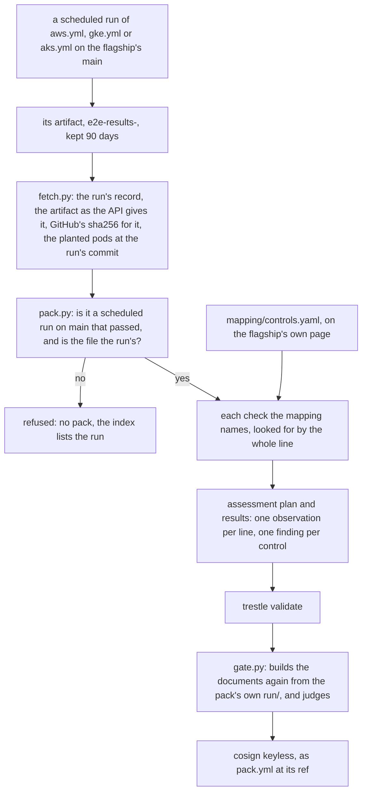

# cloud-evidence-pack

Evidence for a control is usually a screenshot or a spreadsheet, and the reader has to trust whoever assembled it. Each pack here carries the file a scheduled cloud run uploaded itself, and the one command that asks GitHub whether it is that file.

[kubernetes-air-gapped-ai-agent](https://github.com/heyvaldemar/kubernetes-air-gapped-ai-agent) is built on AWS, Google Cloud and Azure on a schedule: a cluster with no way out, tried from inside, then destroyed. This repository reads the record of each of those runs from GitHub, refuses anything that is not a scheduled run on `main` that passed, and turns the run's own check lines into OSCAL assessment results. For each NIST SP 800-53 control: the violation the run tried and was refused, what had to work beside it, and what the control leaves out. One pack per run, validated by [compliance-trestle](https://github.com/oscal-compass/compliance-trestle), signed with cosign.

A pack shows what one scheduled run did. It does not say that any system meets a framework, and no assessor has given an opinion on it.

## What the runs show

Four scheduled runs, each read from its own artifact:

| Cloud | Scheduled run | Date, commit | Lines in its results | Mapped controls satisfied |
|---|---|---|---|---|
| AWS, an EKS cluster in a VPC with no internet gateway and no NAT | [39744285464](https://github.com/heyvaldemar/kubernetes-air-gapped-ai-agent/actions/runs/39744285464) | 2026-10-22, `78fdcc6` | 56, none failed | 6 of 6 |
| Google Cloud, a private GKE cluster in a VPC made without its route to the internet | [42206932411](https://github.com/heyvaldemar/kubernetes-air-gapped-ai-agent/actions/runs/42206932411) | 2026-11-06, `473fa4a` | 63, none failed | 6 of 6 |
| Azure, a network isolated AKS cluster; the boundary alone, with no agent on it | [42809539539](https://github.com/heyvaldemar/kubernetes-air-gapped-ai-agent/actions/runs/42809539539) | 2026-11-10, `a943f70` | 21, none failed | 2 of 2 |
| Azure, the week before | [41626192017](https://github.com/heyvaldemar/kubernetes-air-gapped-ai-agent/actions/runs/41626192017) | 2026-11-03, `27ba3c8` | 21, none failed | 2 of 2 |

The AWS run is the last scheduled one that passed: the two after it, [40845619217](https://github.com/heyvaldemar/kubernetes-air-gapped-ai-agent/actions/runs/40845619217) and [42005832115](https://github.com/heyvaldemar/kubernetes-air-gapped-ai-agent/actions/runs/42005832115), failed, and a failed run gets no pack. The first scheduled GKE run, [41038578800](https://github.com/heyvaldemar/kubernetes-air-gapped-ai-agent/actions/runs/41038578800), failed before it made anything.

## The controls

Six controls of SP 800-53 Rev. 5.2.0. A control is mapped only when three things are true: the flagship's own page, [`docs/compliance.md`](https://github.com/heyvaldemar/kubernetes-air-gapped-ai-agent/blob/v1.9.0/docs/compliance.md), has the row; the check that row names writes a line into the cloud run's results; and the run shows a violation that check refused. [`mapping/controls.yaml`](mapping/controls.yaml) has every line in full.

| Control | Where | The violation tried in the run, and refused | Beside it, what had to work |
|---|---|---|---|
| SC-7 Boundary Protection | AWS, Google Cloud, Azure | A pod and the node each try 1.1.1.1:443, 8.8.8.8:53 and 151.101.0.81:443, a public name, and a public resolver asked directly | A pod starts from the run's own registry by digest; the registry's name resolves to a private address and answers on 443 |
| SC-7(5) Deny by Default, Allow by Exception | AWS, Google Cloud, Azure | The same attempts | Each exception answering: the registry through its private way in |
| AC-4 Information Flow Enforcement | AWS, Google Cloud | With the gateway's pod killed, the model server reached directly | The gateway answers; the harness's own email arrives; no email delivered outside the company's domain |
| SI-7 Software, Firmware, and Information Integrity | AWS, Google Cloud | The signed bundle with one byte changed; a model named by tag | The registry held nothing before, and exactly what the bundle carried after |
| SR-4 Provenance | AWS, Google Cloud | A signed model with no AI-BOM | The signed model with its AI-BOM is admitted |
| SR-11 Component Authenticity | AWS, Google Cloud | Weights nobody signed, weights another key signed, weights from another path, an image the bundle never carried, an image by tag | The signed model is admitted; every running pod runs carried images |

Azure has two controls because its run makes the boundary alone: no agent and no admission policies are installed there, so its results hold none of the other lines.

Each cloud's DNS check has also failed once, by hand, with the resolver's policy left off: AWS [39632816543](https://github.com/heyvaldemar/kubernetes-air-gapped-ai-agent/actions/runs/39632816543), Google Cloud [40560466605](https://github.com/heyvaldemar/kubernetes-air-gapped-ai-agent/actions/runs/40560466605), Azure [41007916564](https://github.com/heyvaldemar/kubernetes-air-gapped-ai-agent/actions/runs/41007916564). Copies of those three runs are in [`tests/fixtures/violations`](tests/fixtures/violations), and a static check holds each to the failed line it is cited for.

**Not mapped, and why.** AU-2 and CM-7: their gates pass in every run, but no scheduled run shows a violation they refused. AC-6 and IA-9: their refusals are the Vault checks, which no scheduled cloud run that passed has run yet. SC-7(10): the runs try ways out, they do not test data leaving through a way that is allowed. SC-8, AU-9, RA-5: nothing in a cloud run. CM-14 is not mapped because the flagship's page does not map it: the model is verified against a public key, not a certificate.

**What every row leaves out** is in the pack beside the row. In short: the boundary is refused, not monitored, and IPv6 is not tried; an email is held to a domain, not to a person; integrity is checked on the way in and not between runs; provenance is a record that is there and signed, not a record shown to be true; authenticity is checked against a key with no transparency log.

## How a pack is made



[`tests/e2e/run.sh`](tests/e2e/run.sh) runs it in this order with the scripts in [`scripts/`](scripts/). There is no cluster and no cloud account in it: the run already happened. No cloud workflow is ever started from here.

## How a control is judged

A control is satisfied in a pack only when all of these hold:

1. The run is the flagship's, by that cloud's own workflow, started by the schedule, on `main`, complete and passed, and the artifact's sha256 is the digest GitHub reports for it.
2. Every check the mapping names for that cloud is in the run's results, by the whole line, and passed. A planted pod's line must carry the words the pod's own file expects, read at the run's commit.
3. At least one of those checks is a refusal, and at least one is something that had to succeed, so a check cannot pass because the environment refuses everything.

A line the mapping names and the run lacks leaves its control not satisfied. A line renamed upstream is never skipped, and where a cloud's run writes two lines, one is not enough.

The gate does not take a pack's findings on trust. [`scripts/gate.py`](scripts/gate.py) builds the documents again from the pack's own `run/` and fails if a byte differs, then reads the findings with trestle's models: one per mapped control, each satisfied. It exits 1 on anything short of that, 2 when the pack cannot be read or its `run/` is not a scheduled run's own file. No evidence is a failure, never a pass, and nothing is signed that the gate has not passed.

## Is the file inside the run's?

Ask GitHub, not the pack. Each pack's `summary.md` ends with the two commands for its own artifact; for the Azure run of 2026-11-10 they are:

```sh
gh api repos/heyvaldemar/kubernetes-air-gapped-ai-agent/actions/artifacts/13761493439 -q .digest
sha256sum evidence/run/e2e-results-aks.zip
```

Both say `95f61d15bf2d8f519e5528989f1e3fd6ba37b5d8dc22d2c3c942c834c6334826`. And the run's own record says who started it:

```sh
gh api repos/heyvaldemar/kubernetes-air-gapped-ai-agent/actions/runs/42809539539 -q '[.event, .head_branch, .path, .conclusion] | join(" ")'
```

**The limit of this.** GitHub keeps an artifact for 90 days; this one expires on 2027-02-08. After that there is nothing to ask, and what remains is the pack's signature and its entry in Sigstore's log, which show that this repository's workflow, at a named commit, built the pack while the artifact still existed. The cloud runs do not sign their own results yet.

## The plants

A gate that has never failed proves nothing. [`scripts/plant.py`](scripts/plant.py) breaks a run or a pack on purpose, [`tests/e2e/plants.sh`](tests/e2e/plants.sh) runs every plant on every committed copy of a real run, and each must be caught for its own reason:

| Plant | What it breaks | The gate must |
|---|---|---|
| `missing:<control>`, one for every control on every cloud | every refusal line the control rests on is gone from the run | call exactly the controls resting on those lines not satisfied |
| `failed:<control>` | one of its refusals says the violation got in | the same, and count the failed line |
| `uncontrolled:<control>` | everything that had to succeed beside the refusals is gone | the same |
| `renamed:<check>`, one for every check | the flagship renamed one line | the same; never skip it |
| `forged-results` | one check flipped inside the artifact | refuse the run: the file is not the one GitHub holds |
| `forged-findings` | a pack edited to say every control is satisfied, over a violation that got in | fail: the documents are not what the run gives. trestle still reads them |
| `by-hand`, `branch`, `other-workflow`, `other-repository`, `red-run`, `other-run`, `no-artifact` | a run that is not a scheduled run's own file | refuse it, for that one reason and no other |

The first full pass missed eight. Two patterns in the mapping ended in "anything", so a renamed line still matched them; and two checks asked for one line where Google Cloud's and Azure's runs write two, so one could vanish behind the other. The mapping now names each line to its end and counts lines cloud by cloud.

The rules are held the same way. [`tests/test_pack.py`](tests/test_pack.py) and [`tests/test_index.py`](tests/test_index.py) feed each rule what breaks it, on the real runs' files; [`scripts/mutate.py`](scripts/mutate.py) switches each rule off in a copy, from [`tests/plants.tsv`](tests/plants.tsv), and requires a named test to fail by an assertion. A test that only crashes on the changed script has judged nothing and counts as missed. [`tests/static/plants.tsv`](tests/static/plants.tsv) breaks the static checks of [`scripts/validate.sh`](scripts/validate.sh), and [`tests/static/plant_violations.py`](tests/static/plant_violations.py) requires the named check to fail on each.

## A cloud that stops running

A scheduled run can fail, and a cloud's schedule can stop. They are different things, and [`scripts/index.py`](scripts/index.py) keeps them apart for every scheduled run of each cloud:

- **pack**: the run passed and its pack passed the gate.
- **run with no pack**: the run failed, or it passed and its evidence was refused. A failure of that week, listed with the run.
- **missing**: the cloud's workflow has no scheduled run in the last 10 days. The leg is reported as missing since its last run. It is not a failure, and the other clouds' packs do not wait for it.

A run that exists and has no pack is never reported as missing.

## What a pack proves, and what it does not

It proves that a named scheduled run of the flagship, on a named cloud, at a named commit, tried the violations listed and was refused each one, beside the things that had to work; that the file saying so is the one that run uploaded; and that the documents were made from that file by this repository's workflow and have not changed since.

It does not prove:

- **That any system meets a framework.** A control's statement asks for more than a run can show. An organisation's procedures, people and reviews are in no run, and no assessor has looked at this.
- **Anything a policy engine reported.** No cloud run keeps Kyverno's reports. The evidence is the run's own check lines. For the admission policies as Kyverno reports them, read through OSCAL Compass's C2P, see [kubernetes-oscal-evidence](https://github.com/heyvaldemar/kubernetes-oscal-evidence), on kind.
- **Anything between runs.** A run is a sample: one cluster, made, tried and destroyed in under an hour.
- **Anything about an install of yours.** The clusters are the flagship's, in its own cloud accounts.

## Check it yourself

A pack is `cloud-evidence-pack-<cloud>-<run id>.tar.gz` with its Sigstore bundle beside it. With the pack unpacked and this repository at the commit that built it:

```sh
python3 -m venv .venv && .venv/bin/pip install --require-hashes --no-deps -r requirements.lock
export PATH="$PWD/.venv/bin:$PATH"
bash scripts/catalogs.sh
bash scripts/validate.sh evidence
python3 scripts/gate.py evidence --live
```

`validate.sh` is trestle's validator over the pack's plan and results. `gate.py` builds the documents again from `evidence/run` and compares; with `--live` it also asks GitHub now for the run's record and the artifact's digest.

## Quickstart

One committed copy of a real run, made into a pack and judged, with no network after the first download of NIST's catalog:

```sh
python3 -m venv .venv && .venv/bin/pip install --require-hashes --no-deps -r requirements.lock
export PATH="$PWD/.venv/bin:$(bash scripts/install-tools.sh):$PATH"
bash scripts/flagship.sh
RUN_DIR=tests/fixtures/runs/aks-42809539539 bash tests/e2e/run.sh
```

The pack lands in `.cache/run/aks-42809539539/evidence`; read `summary.md` first. `PLANT=missing:sc-7` (or any plant `python3 scripts/plant.py all aks` prints) breaks it on purpose. `RUN=<run id>` reads a run from GitHub instead, with `GH_TOKEN` set.

Everything at once, as CI runs it:

```sh
bash scripts/validate.sh
python3 tests/static/plant_violations.py
```

It needs Python 3.11 or later and curl. No Docker, no cluster, no cloud account.

### Teardown

There is nothing to tear down: a run here creates no cluster and no cloud resource. What it downloads and builds stays in `.cache/` and `.venv/`; deleting the two removes all of it.

## What it costs

Runner time on GitHub's hosted runners, and nothing else: no cloud account, no stored secret. The cloud runs it reads are the flagship's and are paid for there; this repository starts none of them.

## Repository

| Path | What it is |
|---|---|
| `mapping/controls.yaml` | The mapping, written for a person: each control, the lines of a run that carry it, what it leaves out |
| `oscal/component-definition.json` | The same mapping as an OSCAL component definition, made by `scripts/component.py` |
| `flagship.lock`, `catalogs.lock`, `tools.lock`, `requirements.lock` | What is fetched, and the hash it must have |
| `scripts/fetch.py`, `pack.py`, `gate.py` | Read a run, build its pack, judge it |
| `scripts/index.py` | Every scheduled run of each cloud, and what became of it |
| `scripts/plant.py`, `mutate.py`, `validate.sh` | The plants, the rules switched off in turn, the static checks |
| `tests/fixtures/runs` | Real scheduled runs, byte for byte as GitHub's API gave them |
| `tests/e2e/run.sh` | The whole run, as CI runs it |

## Questions, bugs and changes

Open an [issue](https://github.com/heyvaldemar/cloud-evidence-pack/issues) for a bug, a question or an idea. Security reports go privately, as [SECURITY.md](SECURITY.md) describes.

## How this is built

One maintainer and an AI agent. The agent writes most of the code; the decisions are mine, and so is the verification. Nothing merges on the agent's report that it works: it merges on the checks above, and each of them has been shown the failure it exists to catch. The rules the agent works under are in [AGENTS.md](AGENTS.md).

## License

[MIT](LICENSE).
