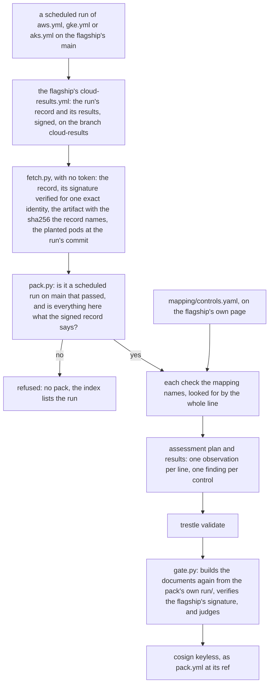

# cloud-evidence-pack

Evidence for a control is usually a screenshot or a spreadsheet, and the reader has to trust whoever assembled it. Each pack here carries the file a scheduled cloud run uploaded itself, signed by the repository that ran the cloud, and the two commands that check it.

[kubernetes-air-gapped-ai-agent](https://github.com/heyvaldemar/kubernetes-air-gapped-ai-agent) is built on AWS, Google Cloud and Azure on a schedule: a cluster with no way out, tried from inside, then destroyed. Since its [ADR 25](https://github.com/heyvaldemar/kubernetes-air-gapped-ai-agent/blob/main/docs/decisions/0025-each-cloud-runs-results-signed-and-kept.md) the flagship signs each finished run's results and keeps them on a branch. This repository reads them from there with no token, verifies the flagship's signature, refuses anything that is not a scheduled run on `main` that passed, and turns the run's own check lines into OSCAL assessment results. For each NIST SP 800-53 control: the violation the run tried and was refused, what had to work beside it, and what the control leaves out. One pack per run, validated by [compliance-trestle](https://github.com/oscal-compass/compliance-trestle), signed with cosign.

A pack shows what one scheduled run did. It does not say that any system meets a framework, and no assessor has given an opinion on it.

## What the runs show

Six scheduled runs, each read from its own artifact:

| Cloud | Scheduled run | Date, commit | Lines in its results | Mapped controls satisfied |
|---|---|---|---|---|
| AWS, an EKS cluster in a VPC with no internet gateway and no NAT | [43199517532](https://github.com/heyvaldemar/kubernetes-air-gapped-ai-agent/actions/runs/43199517532) | 2026-11-12, `612768c` | 121, none failed | 8 of 8 |
| AWS, three weeks before | [39744285464](https://github.com/heyvaldemar/kubernetes-air-gapped-ai-agent/actions/runs/39744285464) | 2026-10-22, `78fdcc6` | 56, none failed | 6 of 6 |
| Google Cloud, a private GKE cluster in a VPC made without its route to the internet | [43414580093](https://github.com/heyvaldemar/kubernetes-air-gapped-ai-agent/actions/runs/43414580093) | 2026-11-13, `bc583c1` | 99, none failed | 8 of 8 |
| Google Cloud, the week before | [42206932411](https://github.com/heyvaldemar/kubernetes-air-gapped-ai-agent/actions/runs/42206932411) | 2026-11-06, `473fa4a` | 63, none failed | 6 of 6 |
| Azure, a network isolated AKS cluster; the boundary alone, with no agent on it | [42809539539](https://github.com/heyvaldemar/kubernetes-air-gapped-ai-agent/actions/runs/42809539539) | 2026-11-10, `a943f70` | 21, none failed | 2 of 2 |
| Azure, the week before | [41626192017](https://github.com/heyvaldemar/kubernetes-air-gapped-ai-agent/actions/runs/41626192017) | 2026-11-03, `27ba3c8` | 21, none failed | 2 of 2 |

Between the two AWS runs the scheduled ones failed, [40845619217](https://github.com/heyvaldemar/kubernetes-air-gapped-ai-agent/actions/runs/40845619217) and [42005832115](https://github.com/heyvaldemar/kubernetes-air-gapped-ai-agent/actions/runs/42005832115), and a failed run gets no pack. The newer AWS run holds 121 lines where the older holds 56, because the flagship grew in those three weeks: Vault, a GPU node, and the agent run a second time on a larger model. The mapping names 60 of the 121. The other 61 are held to one thing: none failed. Google Cloud's newer run holds 99 lines where the older holds 63, and the 36 between them are the Vault checks. The mapping names 60 of the 99. The first scheduled GKE run, [41038578800](https://github.com/heyvaldemar/kubernetes-air-gapped-ai-agent/actions/runs/41038578800), failed before it made anything.

## The controls

Eight controls of SP 800-53 Rev. 5.2.0. A control is mapped only when three things are true: the flagship's own page, [`docs/compliance.md`](https://github.com/heyvaldemar/kubernetes-air-gapped-ai-agent/blob/v1.9.0/docs/compliance.md), has the row; the check that row names writes a line into the cloud run's results; and the run shows a violation that check refused. A planted pod counts for a control only when that row of the page names it. [`mapping/controls.yaml`](mapping/controls.yaml) has every line in full.

| Control | Where | The violation tried in the run, and refused | Beside it, what had to work | Related in ISO/IEC 27001:2022, by NIST's crosswalk |
|---|---|---|---|---|
| SC-7 Boundary Protection | AWS, Google Cloud, Azure | A pod and the node each try 1.1.1.1:443, 8.8.8.8:53 and 151.101.0.81:443, a public name, and a public resolver asked directly | A pod starts from the run's own registry by digest; the registry's name resolves to a private address and answers on 443 | A.5.14, A.8.16, A.8.20, A.8.22, A.8.23 |
| SC-7(5) Deny by Default, Allow by Exception | AWS, Google Cloud, Azure | The same attempts | Each exception answering: the registry through its private way in | nothing |
| AC-4 Information Flow Enforcement | AWS, Google Cloud | With the gateway's pod killed, the model server reached directly | The gateway answers; the harness's own email arrives; no email delivered outside the company's domain | A.5.14, A.8.22, A.8.23 |
| SI-7 Software, Firmware, and Information Integrity | AWS, Google Cloud | The signed bundle with one byte changed; a model named by tag | The registry held nothing before, and exactly what the bundle carried after | nothing |
| SR-4 Provenance | AWS, Google Cloud | A signed model with no AI-BOM | The signed model with its AI-BOM is admitted | A.5.21, A.8.30 |
| SR-11 Component Authenticity | AWS, Google Cloud | Weights nobody signed, weights another key signed, weights from another path, an image the bundle never carried, an image by tag | The signed model is admitted; every running pod runs carried images | nothing |
| AC-6 Least Privilege | AWS, from the run of 2026-11-12; Google Cloud, from the run of 2026-11-13 | Vault asked to log in as the agent, as another service account beside the MCP server, and with the MCP server's token for the Kubernetes API; Vault tried from an agent pod; a delete sent with a credential the records service takes | Vault takes the MCP server's token; the agent pod reaches the MCP server; a record is read with Vault's credential, which names its holder and a scope with no delete in it, and lives 60 seconds | A.5.15, A.8.2, A.8.18 |
| IA-9 Service Identification and Authentication | AWS, from the run of 2026-11-12; Google Cloud, from the run of 2026-11-13 | The records service asked with no credential, a random key, the cluster's own token, a credential for another audience, one that lives an hour and an expired one; Vault asked with the MCP server's token for the Kubernetes API | The records service takes Vault's credential and logs its caller; each credential it refused was really issued; its log gives each refusal a reason of its own | nothing |

Azure has two controls because its run makes the boundary alone: no agent and no admission policies are installed there, so its results hold none of the other lines.

AC-6 and IA-9 rest on the flagship's Vault checks, and a control is asked of a run only from the first scheduled run that carried its lines. On AWS that was [43199517532](https://github.com/heyvaldemar/kubernetes-air-gapped-ai-agent/actions/runs/43199517532) of 2026-11-12, and on Google Cloud [43414580093](https://github.com/heyvaldemar/kubernetes-air-gapped-ai-agent/actions/runs/43414580093) of 2026-11-13. The mapping names each as their `since` for its cloud. Every scheduled run of a cloud from that one on is asked for both, and one that has lost their lines leaves them not satisfied. The AWS run of 2026-10-22 and the Google Cloud run of 2026-11-06 are earlier: each pack has six findings and says the two were not asked of it, because the flagship had no Vault then and nothing is missing from those runs ([ADR 6](docs/decisions/0006-a-control-is-asked-from-the-first-run-that-carried-it.md)). A cloud's first run is its own: a Google Cloud run started after AWS had the lines and before Google Cloud did is still an earlier one.

Each cloud's DNS check has also failed once, by hand, with the resolver's policy left off: AWS [39632816543](https://github.com/heyvaldemar/kubernetes-air-gapped-ai-agent/actions/runs/39632816543), Google Cloud [40560466605](https://github.com/heyvaldemar/kubernetes-air-gapped-ai-agent/actions/runs/40560466605), Azure [41007916564](https://github.com/heyvaldemar/kubernetes-air-gapped-ai-agent/actions/runs/41007916564). Copies of those three runs are in [`tests/fixtures/violations`](tests/fixtures/violations), and a static check holds each to the failed line it is cited for.

**Not mapped, and why.** AU-2 and CM-7: their gates pass in every run, but no scheduled run shows a violation they refused. SC-7(10): the runs try ways out, they do not test data leaving through a way that is allowed. SC-8, AU-9, RA-5: nothing in a cloud run. CM-14 is not mapped because the flagship's page does not map it: the model is verified against a public key, not a certificate. [kubernetes-oscal-evidence](https://github.com/heyvaldemar/kubernetes-oscal-evidence) dropped it for the same reason in its v1.2.0.

**What every row leaves out** is in the pack beside the row. In short: the boundary is refused, not monitored, and IPv6 is not tried; an email is held to a domain, not to a person; integrity is checked on the way in and not between runs; provenance is a record that is there and signed, not a record shown to be true; authenticity is checked against a key with no transparency log; least privilege and the identity of a service are shown for the records credential alone, not for the agent's own tokens or the person it acts for.

## Other frameworks

A related criterion stands beside a finding. It is never a finding.

**ISO/IEC 27001:2022.** The last column above is NIST's own crosswalk from SP 800-53 Rev. 5, [OLIR informative reference 155](https://csrc.nist.gov/projects/olir/informative-reference-catalog/details?referenceId=155), version 1.0.0, posted 2023-11-13. It is read from the spreadsheet NIST serves, pinned by sha256 in [`catalogs.lock`](catalogs.lock), and nothing in it is typed by hand: a pack names what NIST relates to a control, and to that control alone. NIST relates A.8.12 to SC-7(10) and not to SC-7, so it is not in SC-7's row. Where NIST relates nothing, as for SC-7(5), SI-7, SR-11 and IA-9, the pack says "nothing". A crosswalk relates two documents: NIST's page warns against reading its rows as equivalence, and nothing here is a finding about ISO/IEC 27001. One thing met on the way: NIST's page prints the file's hash under the label SHA3-256, and the value is the file's SHA-256.

**SOC 2.** Not in a pack. AICPA publishes its own mapping of the Trust Services Criteria to NIST 800-53, behind a download button on its site beside a log-in, with no address a build can fetch and pin by hash. A SOC 2 column typed in by hand from it would be what this repository does not do. It can be added the day the file can be pinned as NIST's is.

## How a pack is made



[`tests/e2e/run.sh`](tests/e2e/run.sh) runs it in this order with the scripts in [`scripts/`](scripts/). There is no cluster and no cloud account in it: the run already happened. No cloud workflow is ever started from here.

## How a control is judged

A control is satisfied in a pack only when all of these hold:

1. Beside the run is the record the flagship's workflow signed, and what is read of the run and of its artifact is exactly what that record says. The run is the flagship's, by that cloud's own workflow, started by the schedule, on `main`, complete and passed, and the artifact's sha256 is the one the signed record names.
2. Every check the mapping names for that cloud is in the run's results, by the whole line, and passed. A planted pod's line must carry the words the pod's own file expects, read at the run's commit. A control with a `since` is asked from that run on, and never of an earlier one.
3. At least one of those checks is a refusal, and at least one is something that had to succeed, so a check cannot pass because the environment refuses everything.

A line the mapping names and the run lacks leaves its control not satisfied. A line renamed upstream is never skipped, and where a cloud's run writes two lines, one is not enough.

The gate does not take a pack's findings on trust. [`scripts/gate.py`](scripts/gate.py) builds the documents again from the pack's own `run/` and fails if a byte differs, then reads the findings with trestle's models: one per control the run is asked for, each satisfied. It exits 1 on anything short of that, 2 when the pack cannot be read or its `run/` is not a scheduled run's own file. No evidence is a failure, never a pass, and nothing is signed that the gate has not passed.

## Is the file inside the run's?

The repository that ran the cloud says so, and signed it. The flagship's workflow `cloud-results.yml` writes down each finished run's facts and the sha256 of the results the run uploaded, and signs that record keyless on its main. A pack carries the record, its Sigstore bundle and the file, and each pack's `summary.md` ends with the commands for its own run. For the Azure run of 2026-11-10:

```sh
cosign verify-blob evidence/run/record.json --bundle evidence/run/record.json.sigstore.json \
  --certificate-identity https://github.com/heyvaldemar/kubernetes-air-gapped-ai-agent/.github/workflows/cloud-results.yml@refs/heads/main \
  --certificate-oidc-issuer https://token.actions.githubusercontent.com
sha256sum evidence/run/e2e-results-aks.zip
```

The identity is one string: that workflow, on main. The second answer is `95f61d15bf2d8f519e5528989f1e3fd6ba37b5d8dc22d2c3c942c834c6334826`, the value `record.json` gives as `artifact.sha256`. The record also says who started the run: the schedule, on `main`, by `.github/workflows/aks.yml`, and that it passed.

Until GitHub drops the artifact, on 2027-02-08 for this one, it gives the same digest to anyone, with no account:

```sh
curl -s https://api.github.com/repos/heyvaldemar/kubernetes-air-gapped-ai-agent/actions/artifacts/13761493439 | grep '"digest"'
```

The signature does not expire with the artifact. The flagship keeps every finished cloud run this way, failed ones too, on its branch [`cloud-results`](https://github.com/heyvaldemar/kubernetes-air-gapped-ai-agent/tree/cloud-results).

**What this leaves out.** The record is signed after the run, by another workflow of the same repository, from GitHub's record of the run: it shows the flagship vouching for the file, not the cloud job signing it as it wrote it. And a run the flagship's rule refuses has no record: on 2026-11-11 that was one run by hand, 43101489006, whose artifact held a scratch file.

## The plants

A gate that has never failed proves nothing. [`scripts/plant.py`](scripts/plant.py) breaks a run or a pack on purpose, [`tests/e2e/plants.sh`](tests/e2e/plants.sh) runs every plant on every committed copy of a real run, and each must be caught for its own reason:

| Plant | What it breaks | The gate must |
|---|---|---|
| `missing:<control>`, one for every control a run is asked for | every refusal line the control rests on is gone from the run | call exactly the controls resting on those lines not satisfied |
| `failed:<control>` | one of its refusals says the violation got in | the same, and count the failed line |
| `uncontrolled:<control>` | everything that had to succeed beside the refusals is gone | the same |
| `renamed:<check>`, one for every check | the flagship renamed one line | the same; never skip it |
| `forged-results` | one check flipped inside the artifact | refuse the run: the file is not the one the signed record names |
| `forged-record` | the signed record and the run beside it edited alike, so every rule that reads them agrees | refuse it by the signature: cosign does not verify the record, and the gate given the pack and no flag does not pass it |
| `unsigned`, `no-record`, `record-mismatch` | the signature gone, the record gone, or a run's record that is not the signed one | refuse the run, for that one reason |
| `forged-findings` | a pack edited to say every control is satisfied, over a violation that got in | fail: the documents are not what the run gives. trestle still reads them |
| `by-hand`, `branch`, `other-workflow`, `other-repository`, `red-run`, `other-run`, `no-artifact` | a run that is not a scheduled run's own file | refuse it, for that one reason and no other |

In [run 43426012261](https://github.com/heyvaldemar/cloud-evidence-pack/actions/runs/43426012261) that was 354 plants on the six committed runs, each caught for its own reason.

The first full pass, before any of this was pushed, missed eight. Two patterns in the mapping ended in "anything", so a renamed line still matched them; and two checks asked for one line where Google Cloud's and Azure's runs write two, so one could vanish behind the other. The mapping now names each line to its end and counts lines cloud by cloud.

The scheduled AWS run of 2026-11-12, [43199517532](https://github.com/heyvaldemar/kubernetes-air-gapped-ai-agent/actions/runs/43199517532), missed three more, before a pack of it was published. With a GPU, an AWS run takes the agent through the evals a second time, on a larger model, and writes three of AC-4's lines again. Each check asked for one line, so a line lost the second time hid behind the first. The mapping now names the three as written together, and each must have as many lines as the others ([ADR 5](docs/decisions/0005-a-line-written-twice-is-two-lines.md)). That run is the fifth committed copy, and a line a run writes twice is listed and observed twice.

The scheduled Google Cloud run of 2026-11-13, [43414580093](https://github.com/heyvaldemar/kubernetes-air-gapped-ai-agent/actions/runs/43414580093), is the sixth. Its 89 plants were run before a pack of it was kept or released, and none was missed.

The rules are held the same way. [`tests/test_pack.py`](tests/test_pack.py) and [`tests/test_index.py`](tests/test_index.py) feed each rule what breaks it, on the real runs' files; [`scripts/mutate.py`](scripts/mutate.py) switches each rule off in a copy, from [`tests/plants.tsv`](tests/plants.tsv), and requires a named test to fail by an assertion. A test that only crashes on the changed script has judged nothing and counts as missed. [`tests/static/plants.tsv`](tests/static/plants.tsv) breaks the static checks of [`scripts/validate.sh`](scripts/validate.sh), and [`tests/static/plant_violations.py`](tests/static/plant_violations.py) requires the named check to fail on each. The same run: 88 rules switched off and 43 static plants, every one caught.

## A cloud that stops running

A scheduled run can fail, and a cloud's schedule can stop. They are different things, and [`scripts/index.py`](scripts/index.py) keeps them apart for every scheduled run of each cloud:

- **pack**: the run passed and its pack passed the gate.
- **run with no pack**: the run failed, or it passed and its evidence was refused. A failure of that week, listed with the run.
- **missing**: the cloud's workflow has no scheduled run in the last 10 days. The leg is reported as missing since its last run. It is not a failure, and the other clouds' packs do not wait for it.

A run that exists and has no pack is never reported as missing.

## What a pack proves, and what it does not

It proves that a named scheduled run of the flagship, on a named cloud, at a named commit, tried the violations listed and was refused each one, beside the things that had to work; that the file saying so is the one the flagship's own workflow signed as that run's results; and that the documents were made from that file by this repository's workflow and have not changed since.

It does not prove:

- **That any system meets a framework.** A control's statement asks for more than a run can show. An organisation's procedures, people and reviews are in no run, and no assessor has looked at this.
- **Anything a policy engine reported.** No cloud run keeps Kyverno's reports. The evidence is the run's own check lines. For the admission policies as Kyverno reports them, read through OSCAL Compass's C2P, see [kubernetes-oscal-evidence](https://github.com/heyvaldemar/kubernetes-oscal-evidence), on kind.
- **Anything between runs.** A run is a sample: one cluster, made, tried and destroyed in under an hour.
- **Anything about an install of yours.** The clusters are the flagship's, in its own cloud accounts.

## Check it yourself

A pack is `cloud-evidence-pack-<cloud>-<run id>.tar.gz` with its Sigstore bundle beside it. With the pack unpacked and this repository at the commit that built it:

```sh
python3 -m venv .venv && .venv/bin/pip install --require-hashes --no-deps -r requirements.lock
export PATH="$PWD/.venv/bin:$PATH"
bash scripts/catalogs.sh
bash scripts/validate.sh evidence
python3 scripts/gate.py evidence --live
```

`validate.sh` is trestle's validator over the pack's plan and results. `gate.py` builds the documents again from `evidence/run` and compares, and has cosign verify the flagship's signature on the run's record: it does that whenever it is given a pack, and passes nothing without it. With `--live` it also asks GitHub now for the run's record and the artifact's digest. Neither needs a token; cosign must be on the PATH.

## Quickstart

One committed copy of a real run, made into a pack and judged. The network is used for NIST's catalog and the flagship's release the first time, and for Sigstore's trust root each time the gate verifies the flagship's signature:

```sh
python3 -m venv .venv && .venv/bin/pip install --require-hashes --no-deps -r requirements.lock
export PATH="$PWD/.venv/bin:$(bash scripts/install-tools.sh):$PATH"
bash scripts/flagship.sh
RUN_DIR=tests/fixtures/runs/aks-42809539539 bash tests/e2e/run.sh
```

The pack lands in `.cache/run/aks-42809539539/evidence`; read `summary.md` first. `PLANT=missing:sc-7` (or any plant `python3 scripts/plant.py all tests/fixtures/runs/aks-42809539539` prints) breaks it on purpose. `RUN=<run id>` reads a run from the flagship's signed branch instead, with no token.

Everything at once, as CI runs it:

```sh
bash scripts/validate.sh
python3 tests/static/plant_violations.py
```

It needs Python 3.11 or later and curl. No Docker, no cluster, no cloud account.

### Teardown

There is nothing to tear down: a run here creates no cluster and no cloud resource. What it downloads and builds stays in `.cache/` and `.venv/`; deleting the two removes all of it.

## What it costs

Runner time on GitHub's hosted runners, and nothing else: no cloud account, no stored secret. The cloud runs it reads are the flagship's and are paid for there; this repository starts none of them.

## Repository

| Path | What it is |
|---|---|
| `mapping/controls.yaml` | The mapping, written for a person: each control, the lines of a run that carry it, what it leaves out |
| `oscal/component-definition.json` | The same mapping as an OSCAL component definition, made by `scripts/component.py` |
| `flagship.lock`, `catalogs.lock`, `tools.lock`, `requirements.lock` | What is fetched, and the hash it must have: the flagship's release, NIST's catalog and its crosswalk, the tools, trestle |
| `scripts/fetch.py`, `pack.py`, `gate.py` | Read a run from the flagship's signed branch, build its pack, judge it |
| `scripts/index.py` | Every scheduled run of each cloud, and what became of it |
| `scripts/plant.py`, `mutate.py`, `validate.sh` | The plants, the rules switched off in turn, the static checks |
| `scripts/release-verify.sh` | What a release holds, checked as a stranger would: each pack's signature and provenance, and a changed copy refused |
| `tests/fixtures/runs` | Real scheduled runs, each with the record the flagship signed, byte for byte as its branch holds them |
| `tests/e2e/run.sh` | The whole run, as CI runs it |

## Questions, bugs and changes

Open an [issue](https://github.com/heyvaldemar/cloud-evidence-pack/issues) for a bug, a question or an idea. Security reports go privately, as [SECURITY.md](SECURITY.md) describes.

## How this is built

One maintainer and an AI agent. The agent writes most of the code; the decisions are mine, and so is the verification. Nothing merges on the agent's report that it works: it merges on the checks above, and each of them has been shown the failure it exists to catch. The rules the agent works under are in [AGENTS.md](AGENTS.md).

## License

[MIT](LICENSE).
